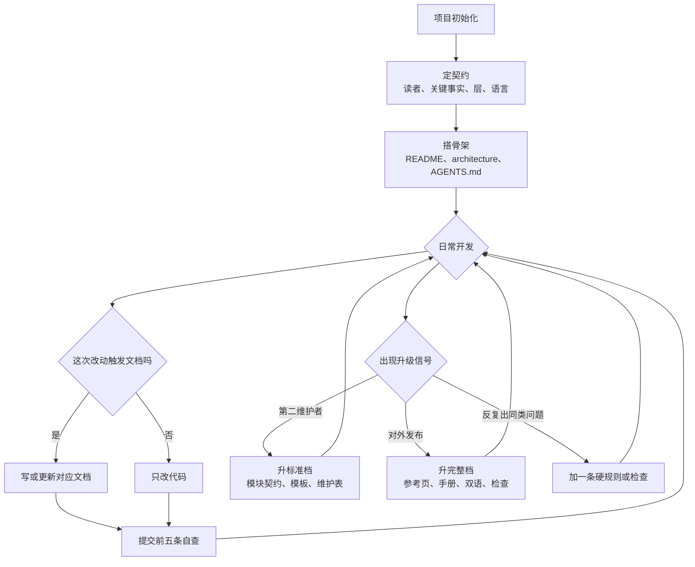
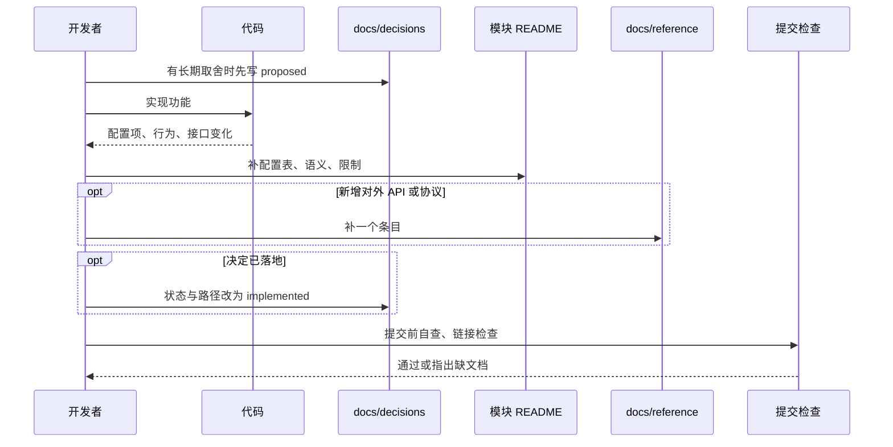
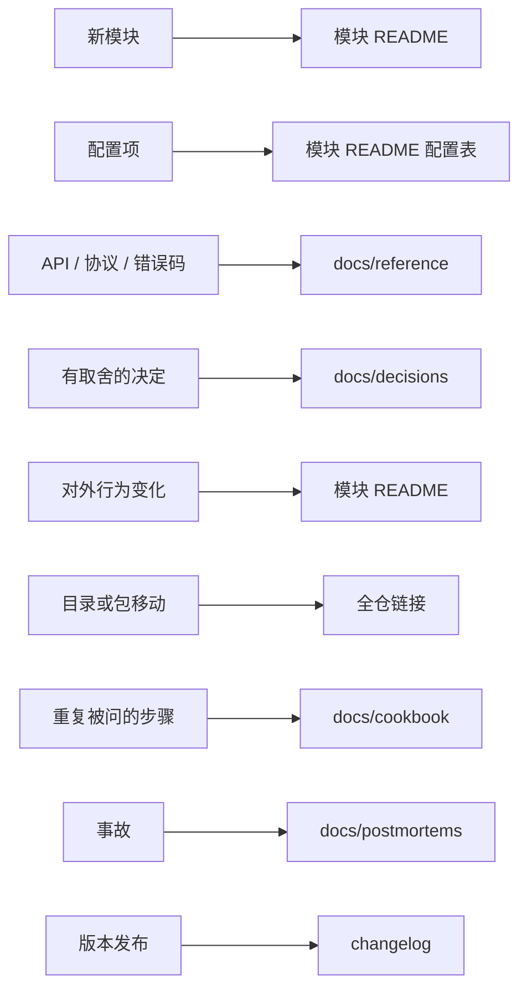
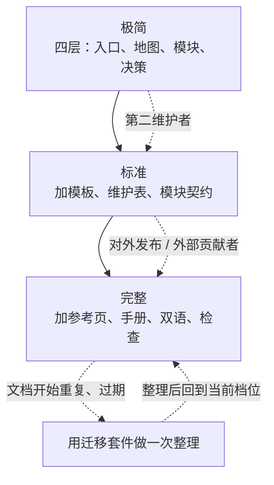

# 参考：项目各时点的文档动作

把「什么时候写什么」画清楚，避免两种极端：一开始铺满空文档，或者一直不写、最后集中补。

## 项目生命周期



关键点：骨架只建一次，之后进入「改代码 → 判断触发 → 写文档 → 自查」的循环。升级是信号驱动，不是按时间表。

## 一次功能开发的文档时序



只有对外契约和长期决策值得先写；模块 README 与首个可用版本同批提交。

## 触发点速查



## 档位升级路径



极简档不是未完成状态。停在极简档，比建一堆没人维护的层更健康。

## 时间线视角

```text
项目开始          第 1 个模块        第 2 个维护者       对外发布
   |                 |                  |                  |
   README           模块 README        标准档             完整档
   architecture     第一个决策记录     维护规则表         参考页 / 双语
   AGENTS.md                                              自动检查
```

每个节点只加当时需要的东西。没有发生节点事件，就不加对应层。