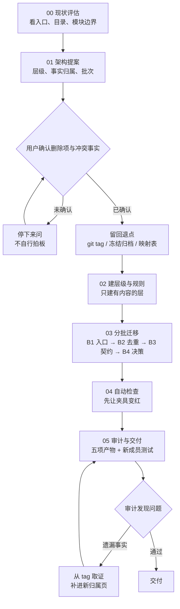
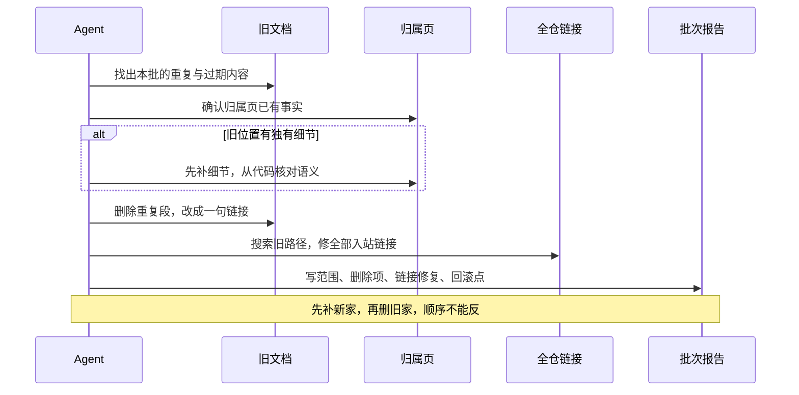
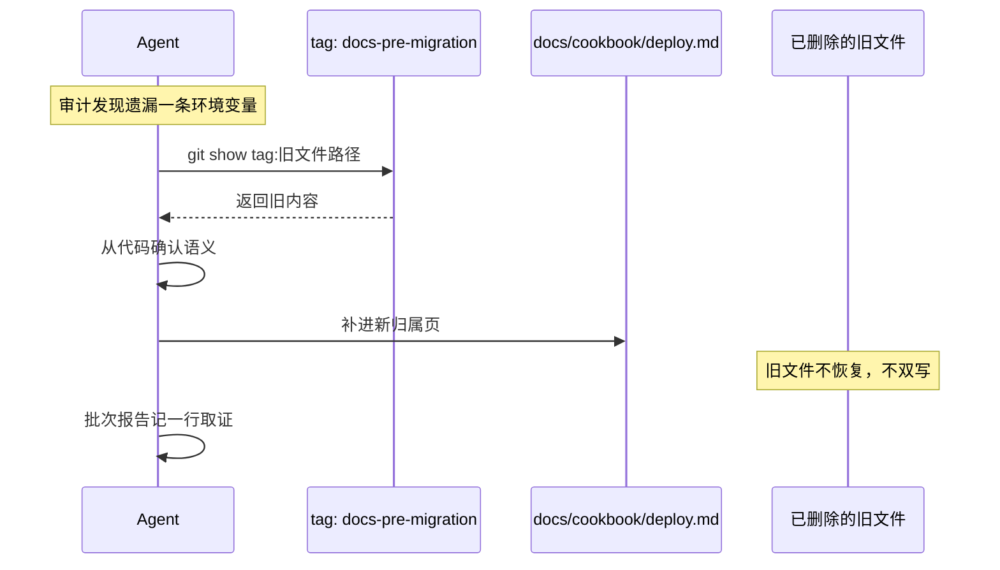
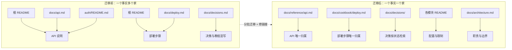

# 图表：Agent 迁移老项目文档的路径

配套正文见 `agent-migrates-docs.md`。这里只放图，方便单独查看。

## 一、六阶段流程与回退点

关键是回退点在迁移之前，不是出问题之后才补。

## 二、单批迁移的内部动作

## 三、回退取证：tag 的正确用法

回退点用来查证，不用来把旧目录重新搬回工作区。

## 四、迁移前后的事实归属

迁移不是把内容搬一遍，是把每条事实的归属重新定一次。