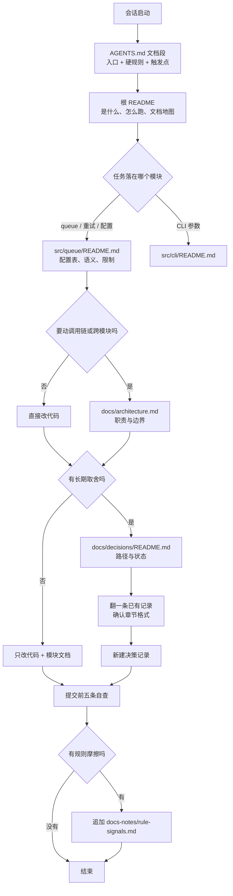
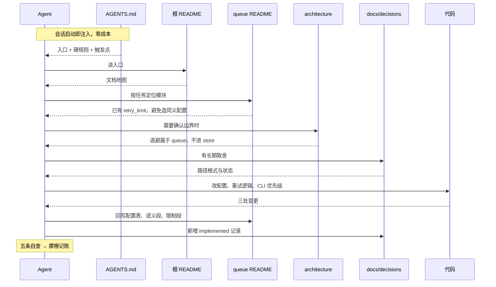
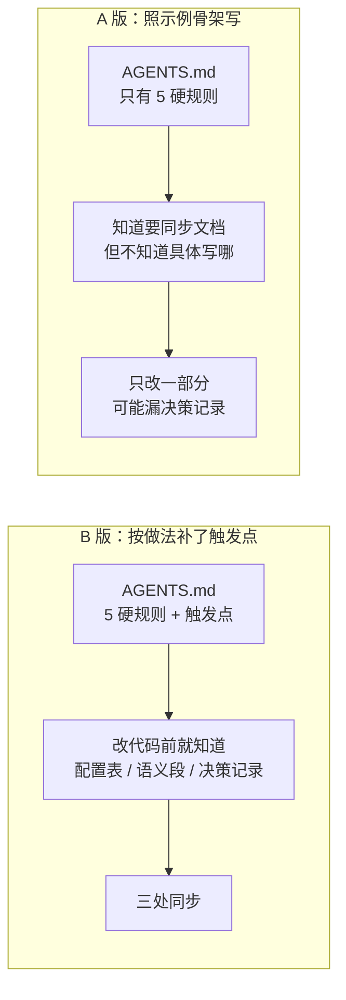
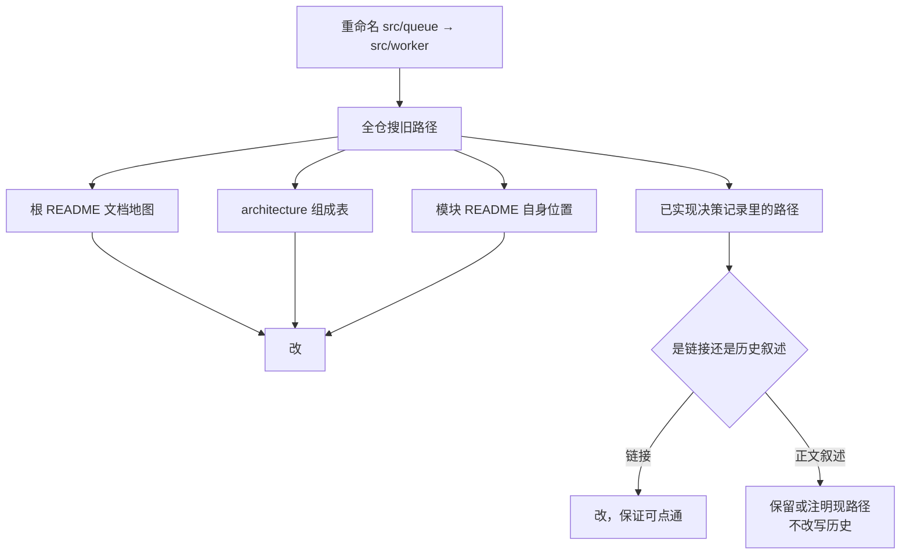

# 图表：Agent 读文档的路径

配套正文见 `agent-reads-docs.md`。这里只放图，方便单独查看。

## 一、读取路由：任务关键词决定读哪层

关键点：`architecture` 和 `decisions` 都是条件分支，不是必经节点。层级是按需展开的。

## 二、一次功能开发的读写时序

只有改代码之前需要「先读」，改完之后的回写是触发点驱动的，不需要再检索一遍全文。

## 三、极简档的断点：示例骨架缺触发点

A 版不是没有规则，是规则停在「要同步」这一层，没有落到可执行的触发点。极简档又没有维护规则表兜底，断点就出现在这里。

## 四、移动目录时的链接修复范围

现在的 skill 把这两类都写成「修路径」，实际执行时需要在「可点通」和「不改历史」之间做一个很小的判断。